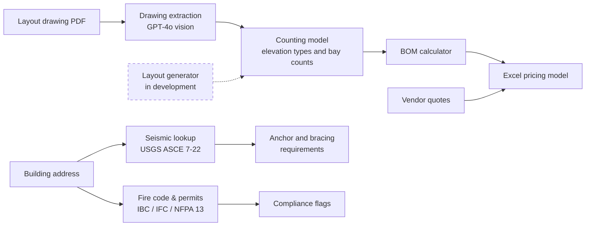

# Racking Design Engine

**A Python tool that reads warehouse layout drawings with a vision model and generates the bill of materials, seismic and fire code checks, and an Excel pricing model. A layout generator is in development.**

I built this, with AI coding tools, while I was Strategic Deal Desk Associate at Prologis Essentials, the logistics services arm of Prologis. **The source code and project data belong to Prologis and contain customer information, so the code is in a private repo.** This page describes how the system works without showing any of that data. I'm happy to walk through the code live.

## The problem

Pricing a warehouse racking project used to take a chain of manual handoffs. Someone read the customer's layout drawing, counted every bay by hand into a spreadsheet, converted the counts into a bill of materials (BOM), checked seismic and fire code requirements, collected vendor quotes and finally built a pricing model. Each step was slow and error-prone, and non-standard deals waited days for a quote.

## What I built

| Component | What it does |
|---|---|
| **Drawing extraction** | Converts layout PDFs to images and sends them to GPT-4o vision, which returns the elevation types and bay counts as structured data for the BOM |
| **BOM calculator** | Converts a counting model into frames, beams, decking, anchors and spacers, using formulas I validated against 6 past customer projects |
| **Layout generator** *(in development, not yet connected)* | Designed to generate a layout from building size, clear height, pallet spec and forklift type: beam levels, aisle widths, row and bay fit, column avoidance, tunnels |
| **Seismic lookup** | Geocodes the site, queries the USGS ASCE 7-22 service and maps the seismic design category to anchor and bracing requirements (anchors are still entered into the BOM by hand) |
| **Fire code & permitting** | Applies high-pile storage thresholds (IBC/IFC Chapter 32, NFPA 13, California Fire Code) and flags permits and sprinkler changes |
| **Pricing model builder** | Combines the BOM with vendor quotes (read from PDF in the browser) and the target margin, and exports a formatted Excel model |

**Stack:** Python, FastAPI, OpenAI vision API, USGS web services, openpyxl, a plain JavaScript front end, and Docker for deployment. About 3,600 lines of Python across 9 modules, plus a browser pricing tool.

## Engineering approach

- **Every assumption is written down for engineers to check.** I kept a separate assumptions document listing each default, such as risk category, site class and anchor mapping by seismic category, with a confidence rating so the engineering team could correct the logic.
- **Validated against real projects before automating.** I checked the BOM formulas against 6 past projects with different rack styles before any of them went into code.
- **Built in stages, each useful alone.** The drawing extraction, BOM calculator, compliance checks and pricing builder each work on their own. Generating the layout itself is the next stage.

## Related work at Prologis

- **AI pricing and underwriting model.** A separate tool from the pricing builder above. It generated deal-level economics and price recommendations for non-standard deals, improving average margin 8% and shortening lead-to-cash 10%.
- **Claude + Zapier contract automation.** It drafts, reviews and routes six contract types, cutting contract creation time 70%.

---

**Ellis Werner** · MBA candidate, UVA Darden School of Business · [LinkedIn](https://www.linkedin.com/in/Ellis-W-Werner) · [GitHub](https://github.com/elliswerner4)
