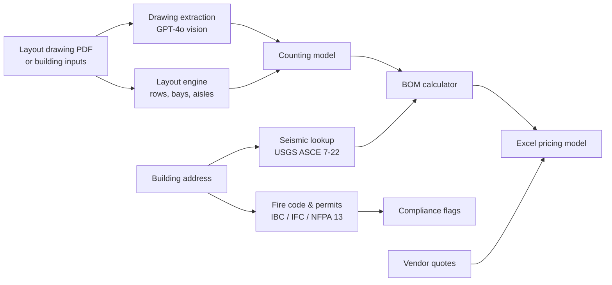

# Racking Design Engine

**An AI-assisted system that turns a warehouse drawing into a racking design, bill of materials, compliance check and pricing model.**

I built this while I was Strategic Deal Desk Associate at Prologis Essentials, the logistics services arm of Prologis. The source code and project data belong to Prologis and contain customer information, so the code lives in a private repo. This page describes how the system works without showing any of that data. I'm happy to walk through the code live.

## The problem

Pricing a warehouse racking project used to take a chain of manual handoffs. Someone read the customer's layout drawing, counted every bay by hand into a spreadsheet, converted the counts into a bill of materials (BOM), checked seismic and fire code requirements, collected vendor quotes and finally built a pricing model. Each step was slow and error-prone, and non-standard deals waited days for a quote.

## What I built

| Component | What it does |
|---|---|
| **Drawing extraction** | Converts layout PDFs to images and uses GPT-4o vision to pull out elevations, bay counts and dimensions as structured data |
| **BOM calculator** | Converts a counting model into frames, beams, decking, anchors and spacers, using formulas I validated against 7 real customer projects |
| **Layout engine** *(in development)* | Generates a layout from building size, clear height, pallet spec and forklift type: beam levels, aisle widths, row and bay fit, column avoidance, tunnels |
| **Seismic lookup** | Geocodes the site, queries the USGS ASCE 7-22 service and maps the seismic design category to anchor and bracing requirements |
| **Fire code & permitting** | Applies high-pile storage thresholds (IBC/IFC Chapter 32, NFPA 13, California Fire Code) and flags permits and sprinkler changes |
| **Pricing model builder** | Combines the BOM with vendor quotes (read from PDF in the browser) and the target margin, and exports a formatted Excel model |

**Stack:** Python, FastAPI, OpenAI vision API, USGS web services, openpyxl, a plain JavaScript front end, and Docker for deployment. About 3,600 lines of Python across 10 modules, plus a browser pricing tool.

## Engineering approach

- **Every assumption is written down for engineers to check.** I kept a separate assumptions document listing each default, such as risk category, site class and anchor mapping by seismic category, with a confidence rating so the engineering team could correct the logic.
- **Validated against real projects before automating.** I checked the BOM formulas against 7 past projects with different rack styles before any of them went into code.
- **Built in stages, each useful alone.** The calculator, compliance checks and pricing builder each worked on their own before the layout engine connected them.

## Related work at Prologis

- **AI pricing and underwriting model.** It produced deal-level price recommendations for non-standard deals, improved average margin 8% and shortened lead-to-cash 10% across a portfolio supporting more than $100M in contracted sales.
- **Agentic contract automation.** An LLM and Zapier system that drafts, reviews and routes six contract types across sales, finance and legal, cutting contract creation time 70%.

---

**Ellis Werner** · MBA candidate, UVA Darden School of Business · [LinkedIn](https://www.linkedin.com/in/Ellis-W-Werner) · [GitHub](https://github.com/elliswerner4)
